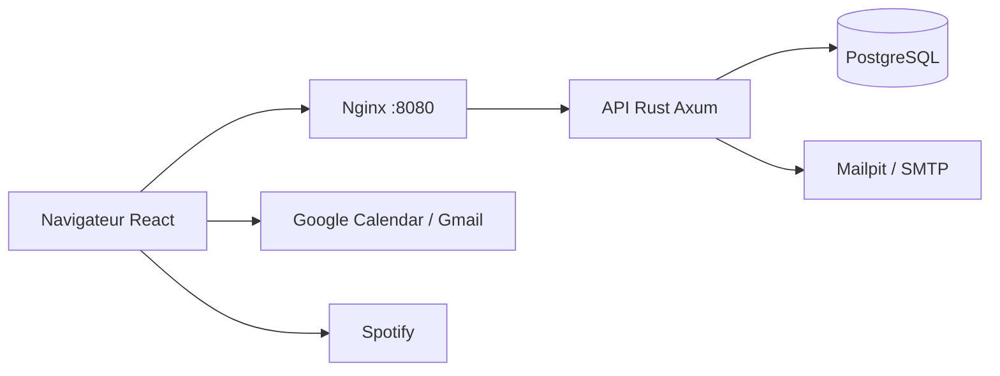

# Lumi

Projet de tableau de bord réalisé dans le cadre du module G-WEB-500.

## Présentation

L'application proposera un tableau de bord personnalisable avec des services et des widgets.

Lumi rassemble des notes, un minuteur de concentration et des widgets dans un tableau de bord personnalisable. L’interface React communique avec une API Rust pour les comptes et les sessions.

Le sujet du projet est disponible dans [dashboard-project.pdf](./dashboard-project.pdf).

La liste des tâches et des priorités est disponible dans [TODO.md](./TODO.md).

Les règles visuelles et les composants de référence sont décrits dans [DESIGN_SYSTEM.md](./DESIGN_SYSTEM.md).

## Technologies utilisées

- Frontend : React en JavaScript (JSX), avec Vite.
- Backend : Rust avec le framework Axum.
- Base de données : PostgreSQL, requêtes et migrations SQLx (sans Prisma).

## Prérequis

Node.js 20.19 ou supérieur, npm, Rust avec Cargo et PostgreSQL 16 (ou Docker Compose pour la base locale).

## Organisation

- `frontend/` : interface React et configuration Vite.
- `backend/` : API Rust avec Axum, documentation OpenAPI et tests.
- `package.json` : commandes communes et workspaces npm.

## Installation

1. Cloner le dépôt et ouvrir le dossier du projet.
2. Installer toutes les dépendances depuis la racine :

```bash
npm install
```

## Configuration

Copier la configuration locale puis démarrer PostgreSQL et la boîte mail locale :

```bash
cp .env.example .env
npm run services
```

`DATABASE_URL` est obligatoire. Le backend charge `.env` et applique les migrations SQLx au démarrage. Le volume Docker conserve les données entre les redémarrages.

En développement, `LUMI_SEED_DEMO=true` crée le compte `demo@lumi.local` / `lumi-demo` s'il n'existe pas. Les variables `LUMI_DEMO_EMAIL` et `LUMI_DEMO_PASSWORD_HASH` permettent de personnaliser le compte lors de sa création. Désactiver ce bootstrap hors développement. Les comptes et sessions sont désormais stockés dans PostgreSQL.

Le backend écoute sur `127.0.0.1:3001` et le frontend sur `localhost:5174`. Vite transmet `/api` au backend via son proxy.

Le périmètre actuel couvre la création de compte et la connexion avec les rôles `perso`, `employe`, `entreprise` et `admin`. Les rôles sont cumulables et contrôlés côté serveur. L'inscription publique ne permet pas de s'attribuer le rôle administrateur.

Le formulaire de connexion demande uniquement l’e-mail et le mot de passe. Le profil se choisit à l’inscription ; le rôle de connexion est déterminé par le serveur. Le tableau de bord propose des widgets personnalisables, enregistrés localement par compte dans le navigateur.

Les quatre comptes de test (un par rôle), leurs identifiants et la commande `npm run seed:test` sont documentés dans [README-COMPTES.md](./README-COMPTES.md).

Voir le [contrat API des comptes](backend/docs/accounts.md) pour le modèle relationnel, les exemples de requêtes et la migration depuis la première version.

## Lancement

### Développement

Depuis la racine :

```bash
npm run dev
```

Ouvrir http://localhost:5174 puis créer un compte ou se connecter. Vite actualise le frontend lors des modifications ; pour une modification Rust, arrêter puis relancer `npm run dev`. Utiliser `Ctrl+C` pour arrêter les deux serveurs.

L’API est aussi accessible directement : http://127.0.0.1:3001/api/health.

### Confirmation et connexion par e-mail

Les nouveaux comptes doivent confirmer leur adresse avant de se connecter. Les comptes de démonstration initialisés par `LUMI_SEED_DEMO=true` ou `npm run seed:test` sont déjà validés et restent accessibles sans e-mail.

En local, lancer `npm run services` avant `npm run dev`. Les e-mails sont consultables dans **http://localhost:8025** (Mailpit) : ils ne sont pas transmis à une boîte externe. Ouvrir le lien reçu puis confirmer l’action. Le renvoi est limité à une demande par minute et cinq par heure, tous types de liens confondus.

Pour recevoir les messages dans une vraie boîte, renseigner dans `.env` les paramètres fournis par le prestataire : `SMTP_HOST`, `SMTP_PORT`, `SMTP_SECURITY=starttls` (port 587) ou `tls` (port 465), `SMTP_USERNAME`, `SMTP_PASSWORD`, ainsi qu’un `MAIL_FROM` autorisé. `APP_URL` doit désigner l’adresse du frontend accessible au destinataire (HTTPS hors localhost). Redémarrer le backend après modification.

Le lien de connexion remplace le mot de passe ; ce parcours n’est pas une seconde étape après le mot de passe (A2F). Les liens de confirmation, connexion et réinitialisation expirent respectivement après 24 heures, 15 minutes et 30 minutes et ne sont utilisables qu’une fois.

### Widgets Google Calendar

Deux widgets permettent de consulter les échéances du mois et le planning semaine/jour, puis de créer des événements avec priorité, labels techniques et échéance. Ils utilisent l’agenda Google principal du compte connecté. Configurer `VITE_GOOGLE_CLIENT_ID` dans `.env` puis redémarrer le frontend : voir le [guide Google Calendar](frontend/docs/google-calendar.md).

Pour connecter un agenda en tant qu'utilisateur :

1. Se connecter à Lumi.
2. Cliquer sur **Ajouter un widget**, puis choisir un widget **Agenda**.
3. Cliquer sur **Connecter Google Calendar**.
4. Choisir le compte Google à utiliser dans la fenêtre Google et accepter l'accès aux événements.

La connexion est valable pour la session de la page. Elle n'enregistre ni mot de passe Google ni secret dans Lumi. Si le bouton n'est pas disponible, l'application doit d'abord être configurée par la personne qui la déploie, comme indiqué dans le [guide complet Google Calendar](frontend/docs/google-calendar.md).

### Documentation interactive — Swagger UI

Avec `npm run dev` lancé, ouvrir http://localhost:5174/api/docs (ou directement http://127.0.0.1:3001/api/docs).

Déplier **GET /api/health**, cliquer sur **Try it out**, puis **Execute** pour envoyer une requête et afficher la réponse du backend.

La spécification OpenAPI est disponible sur `/api/openapi.json`. Elle est définie à partir des annotations Rust dans `backend/src/lib.rs`, `auth.rs`. Les routes privées sont testables avec le bouton **Authorize** et le jeton reçu à la connexion. Les fichiers Swagger UI sont servis localement par le backend, sans CDN.

### Compilation et production

```bash
npm run build
npm start
```

`npm start` lance uniquement le backend compilé. Pour déployer le frontend, servir les fichiers de `frontend/dist/` avec un serveur web et configurer ce serveur pour transmettre `/api` au backend. Le lancement Docker complet est décrit ci-dessous.

## Tests

```bash
npm test
```

Les tests backend utilisent `DATABASE_URL` et une base PostgreSQL isolée par scénario ; le compte de test doit pouvoir créer des bases. Ils vérifient l’inscription, les rôles cumulables, le contrôle du rôle de connexion, les sessions et l’unicité des comptes. Voir les [instructions détaillées](backend/docs/accounts.md#vérifications).

## Équipe

- [Nom du membre — rôle]

## Licence

La licence reste à définir. Voir [LICENCE.md](./LICENCE.md).

## Lancement complet avec Docker

Depuis un clone, copier `.env.example` vers `.env`, puis lancer :

```bash
docker compose build
docker compose up -d --wait
```

Ouvrir **http://localhost:8080**. Nginx sert React et transmet `/api` et `/about.json` au backend Rust ; PostgreSQL et Mailpit démarrent avec l’application. Les migrations sont appliquées automatiquement. Les e-mails locaux restent consultables sur http://localhost:8025. `docker-compose build` et `docker-compose up` conviennent également si le binaire Compose historique est installé.

Le fichier racine est `docker-compose.yml`. `npm run services` continue à ne lancer que PostgreSQL et Mailpit pour le développement. `docker compose down` arrête la stack sans effacer les données ; ne pas ajouter `-v` si les comptes doivent être conservés.

`DOCKER_APP_URL` permet de changer l’origine utilisée dans les liens e-mail Docker (défaut `http://localhost:8080`). Cette stack utilise Mailpit ; pour un déploiement public, configurer un serveur SMTP réel et HTTPS. Les identifiants OAuth `VITE_GOOGLE_CLIENT_ID` et `VITE_SPOTIFY_CLIENT_ID` sont injectés à la compilation : reconstruire l’image frontend après modification et autoriser l’origine/URL de retour correspondante chez le fournisseur.

Le backend Docker n’expose pas son port à l’hôte. `TRUST_PROXY=true` lui permet de lire l’IP fournie par Nginx, qui remplace l’en-tête client ; ne pas activer cette option pour un backend directement accessible.

## Services et widgets

Tous les widgets possèdent un titre et une taille configurables.

| Service | Widget | Paramètres spécifiques | État |
| --- | --- | --- | --- |
| Spotify | Lecture en cours | Client ID, rafraîchissement 5–120 s | OAuth PKCE, validation avec compte réel restante |
| Spotify | Top titres | Client ID, période, 1–10 titres | Chargement à l’ouverture/configuration |
| Gmail | Non lus | Client ID, 1–20 messages | OAuth, actualisation chaque minute |
| Gmail | Rédiger | Client ID, compte indicatif | Envoi explicite depuis Lumi |
| Google Calendar | Échéances du mois | Titre | Agenda principal connecté |
| Google Calendar | Planning semaine/jour | Titre | Agenda principal connecté |
| Local | Notes | Contenu | Enregistré dans le navigateur |
| Local | Focus | Durée 5–120 minutes | Minuteur local |
| Démonstration | Météo | Ville | Données fictives, aucun service météo connecté |

Voir les guides [Calendar](frontend/docs/google-calendar.md) et [Gmail](frontend/src/widgets/gmail/README.md). Les autorisations externes nécessitent une configuration fournisseur ; leur présence dans le catalogue ne prouve pas une validation de bout en bout. Le catalogue machine est disponible publiquement sur `/about.json`, avec l’IP du client, l’heure Unix et les paramètres de type `integer` ou `string`. Le groupe `local` y identifie les outils locaux et la démonstration, sans constituer un service externe.

## Architecture



Les comptes et sessions sont conservés en PostgreSQL. Les dashboards restent pour le moment dans le stockage local, isolés par identifiant utilisateur. Les intégrations externes sont appelées depuis le navigateur ; les jetons Google restent en mémoire, et les jetons Spotify/GitHub sont conservés uniquement en mémoire, liés à la session Lumi. Les routes privées utilisent la session et les permissions vérifiées par le serveur.

## Sécurité des connexions externes

Les jetons Spotify et GitHub ne sont plus persistés dans `localStorage` ou `sessionStorage`. Les anciens jetons stockés sont supprimés lors de l’accès au module de session. Ils sont effacés à la déconnexion et deviennent inaccessibles lorsque la session Lumi change. Une reconnexion au fournisseur est nécessaire après rechargement. Le matériel temporaire PKCE Spotify reste dans `sessionStorage` le temps du retour OAuth, lié à la session Lumi initiatrice ; une réponse tardive d’une ancienne session est refusée.

Pour Spotify en local, ouvrir Lumi sur `http://127.0.0.1:8080` (ou `:5174` en développement) et s’y connecter avant d’autoriser Spotify, afin de garder la même origine au retour OAuth. Les requêtes Spotify authentifiées sont limitées à `https://api.spotify.com/v1/` et refusent les redirections.

Nginx et l’API ajoutent les en-têtes `X-Content-Type-Options`, `X-Frame-Options` et `Referrer-Policy`. L’API interdit la mise en cache. Les dashboards restent dans le stockage local par utilisateur : cette séparation ne protège pas contre une personne ayant accès au profil navigateur. Une protection XSS complète, la limitation des tentatives de connexion et la persistance serveur restent à traiter ; HTTPS doit être configuré pour un déploiement public.
